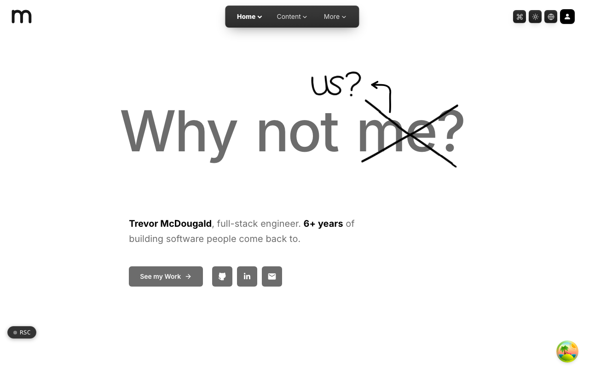
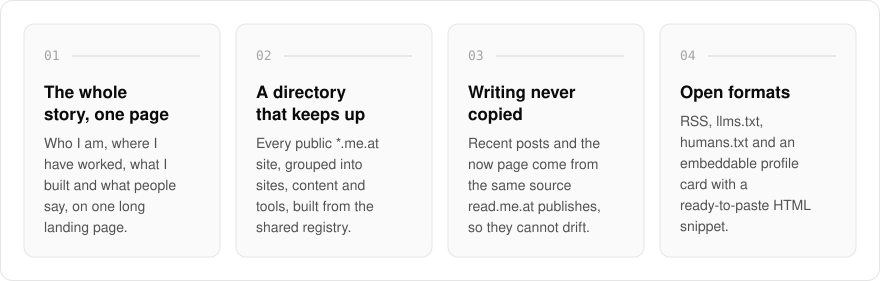
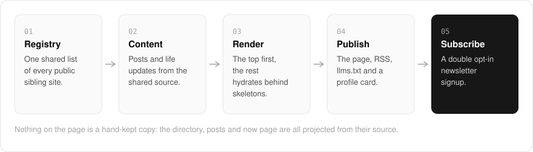

  <picture>
    <source media="(prefers-color-scheme: dark)" srcset=".github/assets/hero-dark.png">
    
  </picture>

<h1 align="center">me.at</h1>

<strong>I'm a full-stack engineer with 7+ years of building software people come back to.</strong>

  
  
  

  <a href="https://me.at">Website</a> ·
  <a href="#features">Features</a> ·
  <a href="#how-it-works">How it works</a> ·
  <a href="#screenshots">Screenshots</a> ·
  <a href="#built-with">Built with</a>

Getting a real sense of an engineer usually means piecing together a resume, a GitHub profile and a scattered set of links. I built me.at so it starts in one place: who I am, where I have worked, what I have built, what people I have worked with say, and my latest writing, all on one long page. It is also the front door of my `*.me.at` family, with a directory of every public sibling site, and my long-form writing lives on [read.me.at](https://read.me.at).

  <picture>
    <source media="(prefers-color-scheme: dark)" srcset=".github/assets/overview-dark.svg">
    
  </picture>

## Why me.at

- **One front door**: every public `*.me.at` site is listed from the family's shared registry, so the directory never falls behind the network.
- **Nothing written twice**: recent posts, the RSS feed and the now page read the same content read.me.at publishes, so they cannot drift.
- **Readable by machines too**: RSS, `llms.txt`, `humans.txt` and an embeddable profile card sit next to the page.

## Features

- **Landing page**: a hero, About Me, a work experience timeline, projects, testimonials and references, and recently updated posts, with sections below the fold lazily hydrated behind skeletons.
- **Network directory**: every public `*.me.at` site, grouped into sites, content and tools, built from the family's shared registry rather than a hand-kept list.
- **Now page**: what I am focused on right now, projected from my newest life update and linked to its full text on read.me.at.
- **Newsletter signup**: double opt-in capture with confirmation tokens and rate limiting.
- **Embeddable profile card**: a `/card.svg` image with a ready-to-paste HTML snippet.
- **Feeds and text files**: RSS, `llms.txt` and `humans.txt`.
- **Shared accounts**: email and password sign-in, account and password-reset pages shared with the rest of the family.
- **Light and dark themes, multiple languages**: theme and locale switchers in the shared header.

## How it works

  <picture>
    <source media="(prefers-color-scheme: dark)" srcset=".github/assets/flow-dark.svg">
    
  </picture>

The directory is built from the family's shared registry, and the recent posts, RSS feed and now page read the same content that read.me.at publishes, so nothing is kept by hand in two places. The top of the page renders first and the sections below the fold hydrate lazily behind skeletons. Newsletter signups are double opt-in, with confirmation tokens and rate limiting.

## Screenshots

<table>
  <tr>
    <td width="50%"><picture><source media="(prefers-color-scheme: dark)" srcset=".github/assets/hero-dark.png"></picture> The landing page, from the top.</td>
    <td width="50%"><picture><source media="(prefers-color-scheme: dark)" srcset=".github/assets/now-dark.png"></picture> Now: what I am focused on right now, taken from my newest life update on read.me.at.</td>
  </tr>
</table>

## Built with

  
  
  
  
  
  

- Next.js 16 (App Router), React 19, TypeScript
- Tailwind CSS 4
- Motion and GSAP for animation
- Better Auth
- Drizzle ORM + Postgres
- Resend for newsletter email
- PostHog analytics (consent-gated), deployed on Vercel

## The me.at family

me.at is the hub of the `*.me.at` network: a family of small sites and products I build, each on its own subdomain, most named so the address reads as a sentence ("read me at", "find me at", "hire me at"). They share one design system, one account, and one app shell (header, footer, auth, locales and legal pages), and they are built in a single private monorepo. Apps get a public-facing GitHub repository that carries their README and screenshots.

Some public members of the family:

| Domain | What it is |
| --- | --- |
| [read.me.at](https://github.com/mcdougald/read.me.at) | Writing, notes and project write-ups: the long-form home for the blog. |
| [find.me.at](https://github.com/mcdougald/find.me.at) | Every place to find me online, in one link hub. |
| [use.me.at](https://github.com/mcdougald/use.me.at) | The hardware, editor and software I use day to day. |
| `about.me.at` | Background, skills and the path so far. |
| `beat.me.at` | A free solo browser arcade of hand-built games with a public leaderboard. |
| `try.me.at` | Interactive in-browser demos of portfolio projects. |
| `ping.me.at` | Status pages that only report what they saw, including the network's own board. |
| `trust.me.at` | A zero-knowledge secrets manager: a vault encrypted in your browser, with share links that expire. |
| `domain.me.at` | Domain portfolio tracking: expiry reminders and DNS and TLS change detection. |
| `design.me.at` | Versioned design tokens, published as CSS variables, a Tailwind theme or DTCG JSON. |
| `hire.me.at` | Career ops for job seekers: an application pipeline and a resume studio. |
| `protect.me.at` | The privacy policy and terms every app in the network points at. |
| `lost.me.at` | Find every live domain and resolve short or moved links. |

## License

Source-available. See [LICENSE](LICENSE).
